# 📇 Contact CRM — Application Web Angular

Application web complète de gestion de la relation client (CRM) développée avec **Angular** (architecture Standalone Components) et **TypeScript**. Elle permet de centraliser, organiser et filtrer ses contacts professionnels par catégories, de gérer une liste de favoris et de visualiser des statistiques en temps réel depuis un tableau de bord.

## ✨ Fonctionnalités principales

- **Tableau de bord analytique (`/`)** : Vue d'ensemble avec compteurs dynamiques (total des contacts, favoris, catégories actives), répartition détaillée par catégorie et accès rapide aux 5 derniers contacts ajoutés.
- **Gestion complète des Contacts (CRUD)** :
  - Création et modification via un formulaire réactif avec validation (`ReactiveFormsModule`).
  - Recherche instantanée (prénom, nom, email, entreprise), filtrage par catégorie, filtre favoris uniquement et tri dynamique (alphabétique ou chronologique).
  - Consultation d'une fiche détaillée (`/contacts/:id`) et suppression avec boîte de confirmation.
- **Gestion des Catégories** : Création avec sélecteur de couleur personnalisé, modification, liste globale et vue filtrée des contacts rattachés à une catégorie (`/categories/:id`).
- **Espace Favoris (`/favorites`)** : Accès dédié aux contacts marqués d'une étoile (`★`) avec bascule instantanée.
- **Persistance locale** : Sauvegarde automatique de toutes les données dans le `localStorage` du navigateur.

## 📸 Démonstration complète de l'application

### 1. Tableau de bord initial et navigation
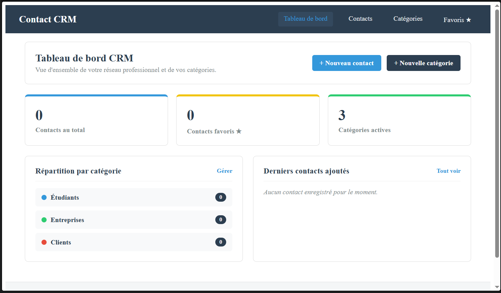

### 2. Filtres et options de tri sur la liste des contacts
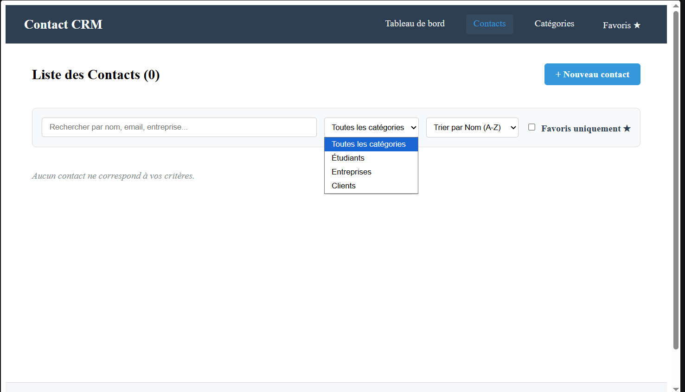
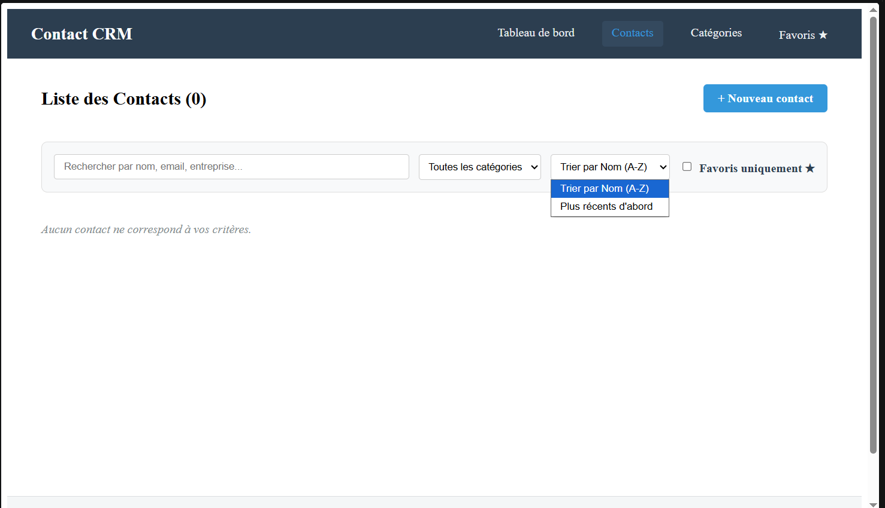

### 3. Création d'un contact et validation du formulaire réactif
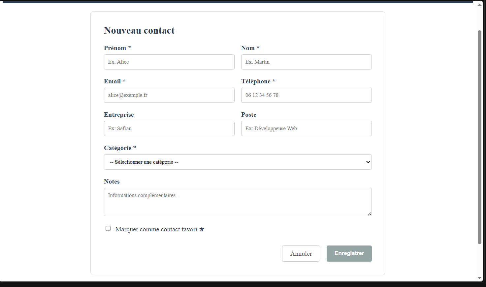
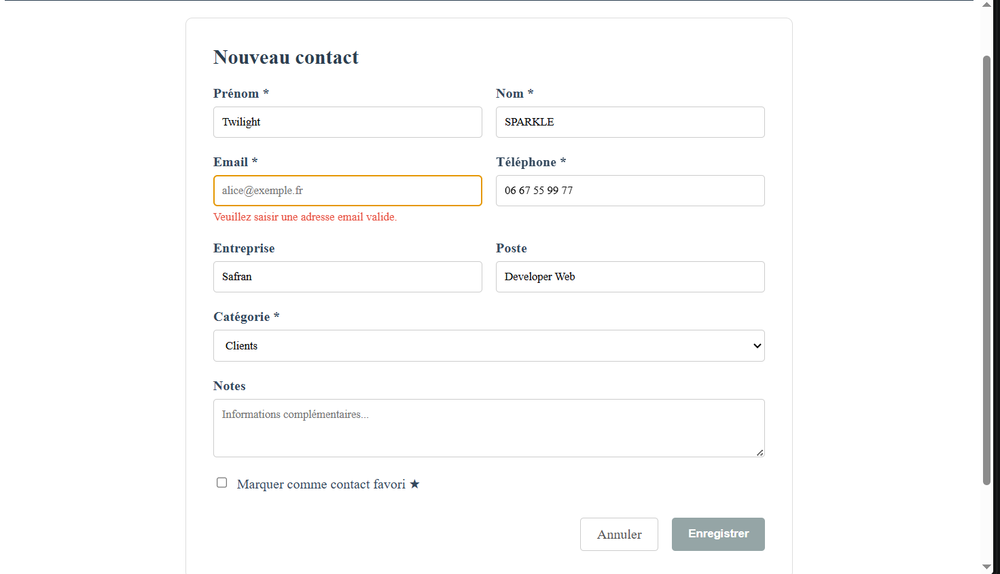

### 4. Affichage des contacts, filtres par catégorie, tri et favoris
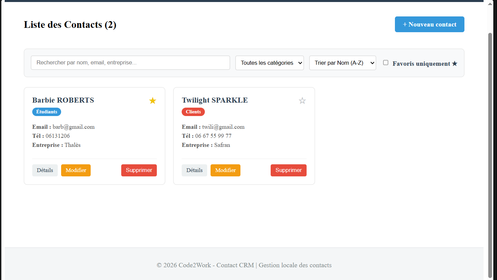
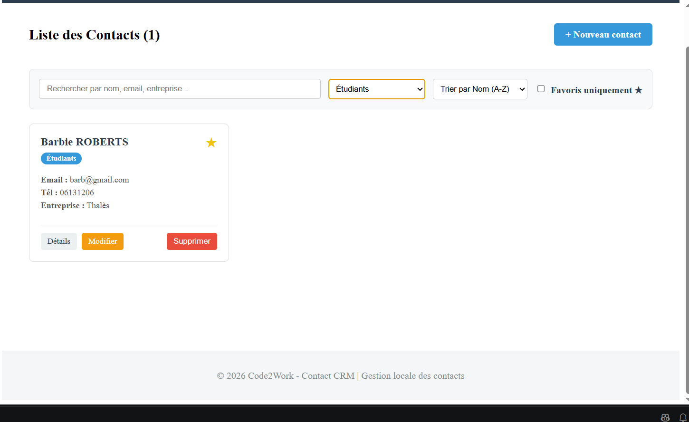
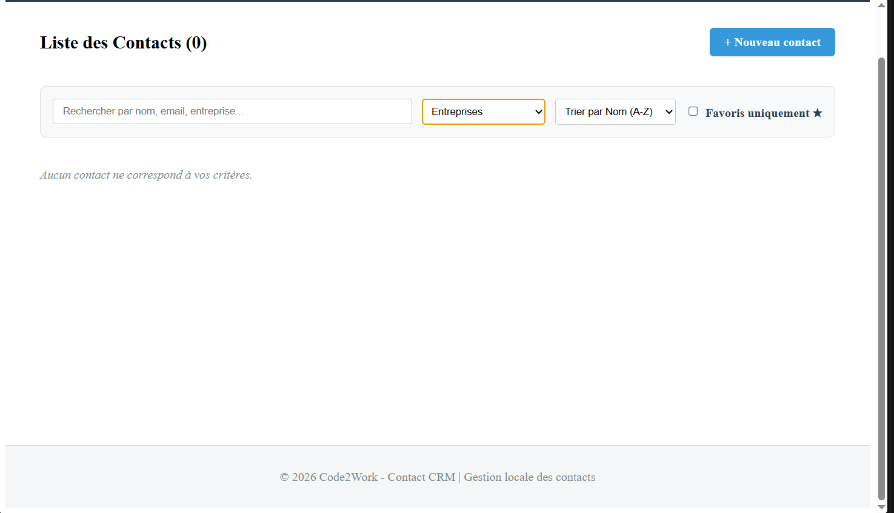
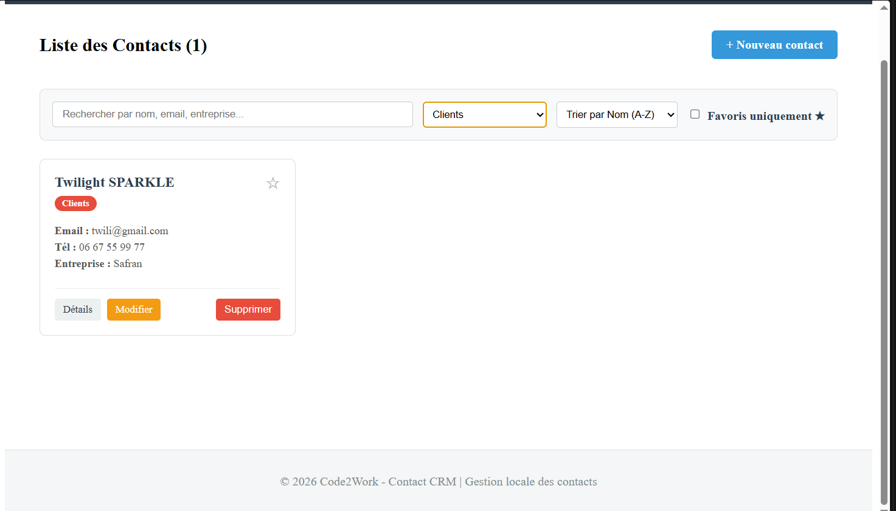
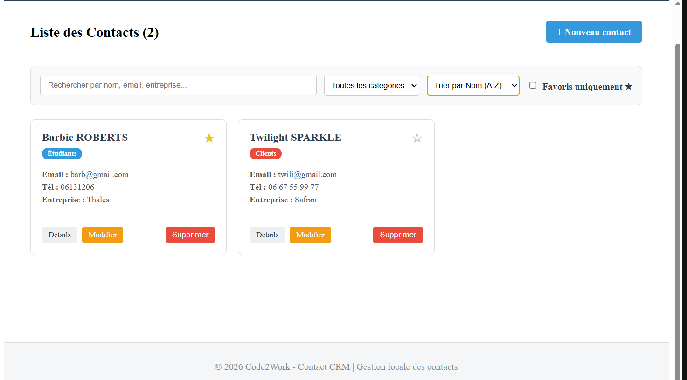
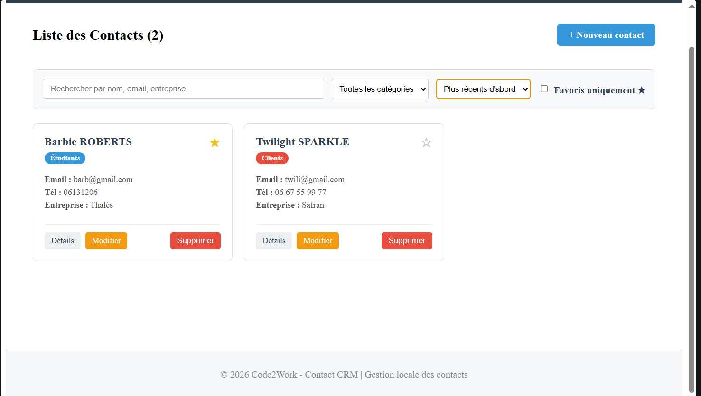
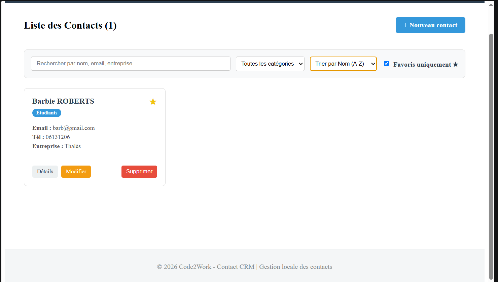

### 5. Consultation, modification et suppression d'un contact
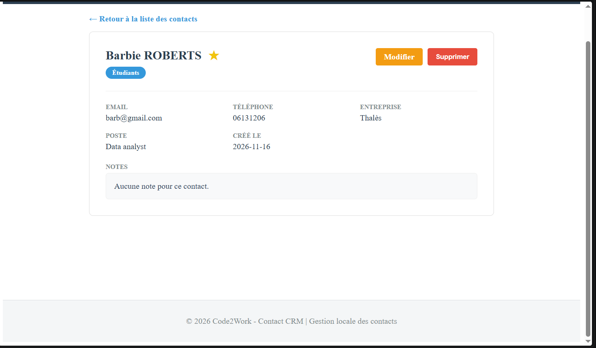
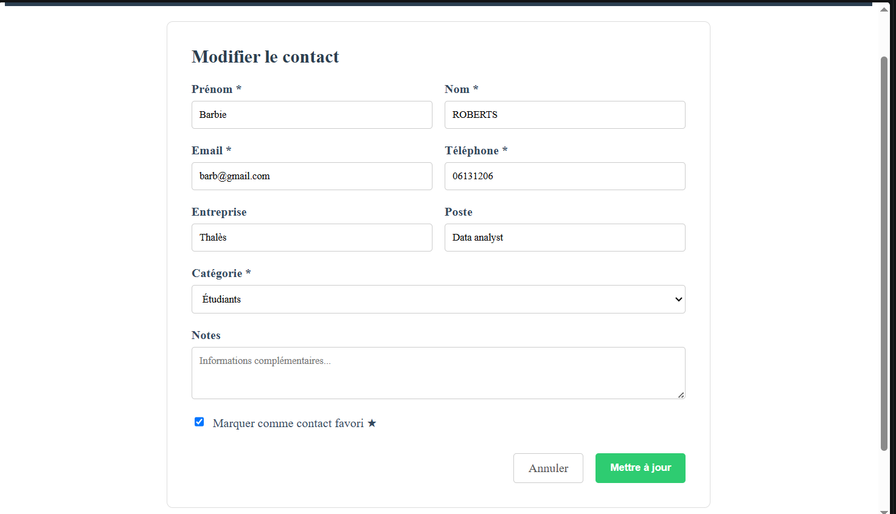
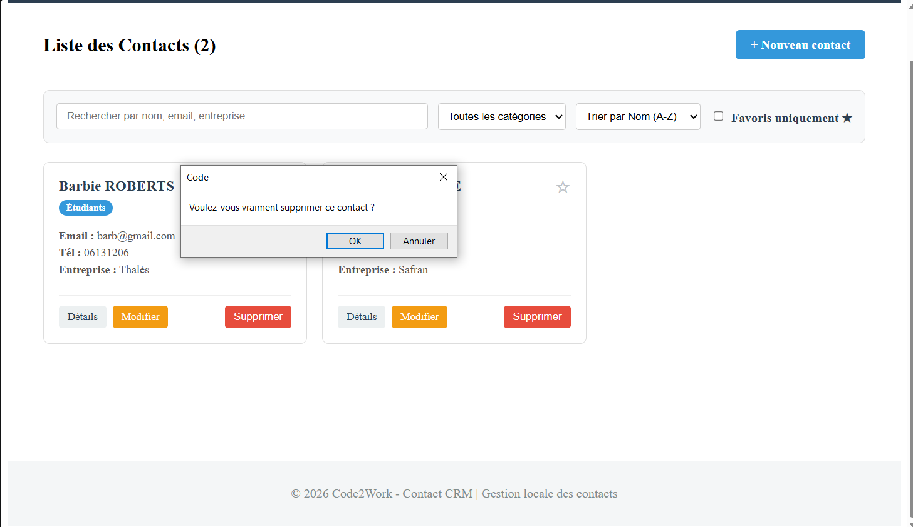

## 🛠️ Technologies & Concepts Angular utilisés

- **Framework** : Angular (Standalone Components, Control Flow moderne `@if`, `@for`, `@empty`)
- **Langage** : TypeScript (interfaces strictes, typage fort)
- **Routage** : `RouterModule` (`RouterLink`, `RouterOutlet`, `ActivatedRoute`, routes paramétrées `:id`)
- **Formulaires** : `ReactiveFormsModule` (`FormBuilder`, `Validators`, `.patchValue()`) et `FormsModule` (`[(ngModel)]`)
- **Architecture** : Injection de dépendances moderne via `inject()`, service centralisé (`CrmService`) et CSS personnalisé responsive.

## 🚀 Installation et lancement

1. **Cloner le dépôt et installer les dépendances :**
   ```bash
   npm install